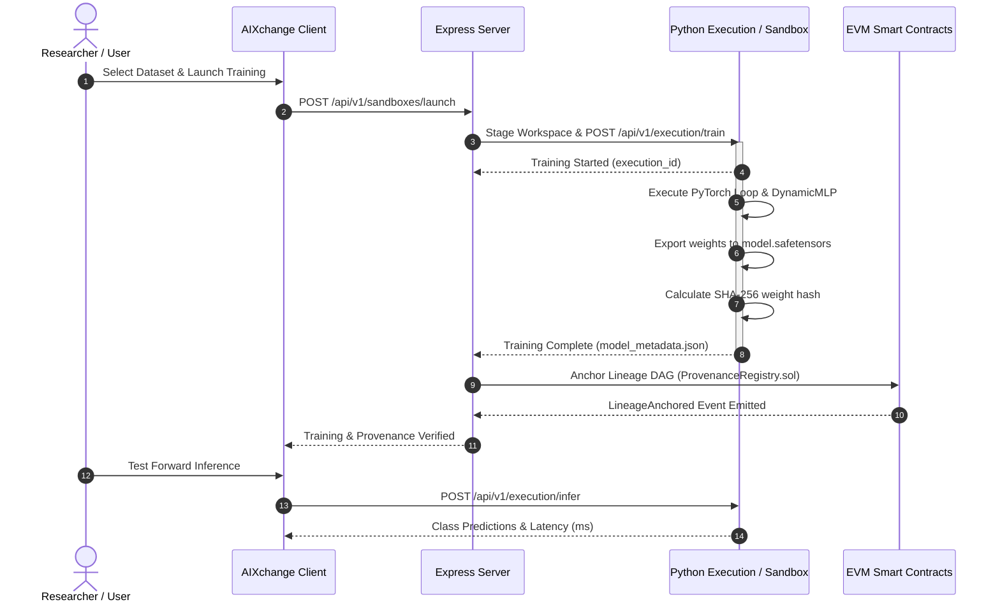

# AIXchange — A Blockchain-Powered Marketplace for AI Datasets and Models

**AIXchange** is an enterprise-grade, decentralized marketplace and execution substrate connecting dataset creators, machine learning engineers, and decentralized organizations. It brings transparency, cryptographic ownership, verifiable dataset-to-model lineage (provenance), atomic cryptocurrency settlement using the **AIX ERC-20 token**, and automated secondary royalty distributions to the modern artificial intelligence lifecycle.

The platform decouples compute-heavy model training and binary storage from on-chain logic: raw datasets and Safetensors model weights are encrypted and stored via decentralized IPFS pinning, while **Ethereum smart contracts (Solidity ^0.8.28)** govern immutable ownership records, access licensing, purchase settlement, lineage DAG anchoring, and multi-party revenue splits.

---

## 📖 Table of Contents

1. [Project Overview](#1-project-overview)
2. [Key Features](#2-key-features)
3. [System Architecture](#3-system-architecture)
4. [Technology Stack](#4-technology-stack)
5. [Repository Structure](#5-repository-structure)
6. [System Requirements & Prerequisites](#6-system-requirements--prerequisites)
7. [Environment Configuration](#7-environment-configuration)
8. [First-Time Installation & Setup](#8-first-time-installation--setup)
9. [Running the Complete Project Locally (The Exact Five-Terminal Workflow)](#9-running-the-complete-project-locally-the-exact-five-terminal-workflow)
10. [Accessing the Application](#10-accessing-the-application)
11. [Smart Contract Deployment via Hardhat Ignition](#11-smart-contract-deployment-via-hardhat-ignition)
12. [Wallet & MetaMask Setup](#12-wallet--metamask-setup)
13. [Backend API Documentation](#13-backend-api-documentation)
14. [AI Training, Provenance & Inference Workflow](#14-ai-training-provenance--inference-workflow)
15. [Blockchain, Dataset Ownership & Lineage DAG](#15-blockchain-dataset-ownership--lineage-dag)
16. [Automated Testing & Validation](#16-automated-testing--validation)
17. [Troubleshooting & FAQ](#17-troubleshooting--faq)
18. [Security Invariants & Safeguards](#18-security-invariants--safeguards)
19. [Academic & Research Context](#19-academic--research-context)
20. [Project Roadmap & Phase Progress](#20-project-roadmap--phase-progress)
21. [Contribution Guidelines](#21-contribution-guidelines)
22. [License & Acknowledgements](#22-license--acknowledgements)

---

## 1. Project Overview

### The Challenges AIXchange Addresses

1. **Unattributed Data Exploitation**: Machine learning practitioners and companies routinely harvest open-source datasets without attribution, persistent licensing constraints, or fair economic compensation to original contributors.
2. **Missing Model Lineage (Provenance)**: Downstream AI consumers have no cryptographic guarantee of which datasets, training code versions, and hyperparameters produced a specific set of model weights.
3. **Broken Royalty Attribution**: When proprietary models monetize downstream, upstream data curators receive zero residual compensation due to disconnected economic pipelines.
4. **Untrusted Code Execution**: Running arbitrary training scripts or Jupyter notebooks on local infrastructure introduces serious security risks, including malware execution and data exfiltration.

### The AIXchange Solution

AIXchange establishes an end-to-end decentralized substrate:

- **Immutable Ownership**: Datasets and models are registered on Ethereum smart contracts with SHA-256 cryptographic digests and IPFS Content Identifiers (CIDs).
- **Atomic Settlement**: Purchases and license acquisitions settle trustlessly in native **AIX tokens** via the `PurchaseEngine` contract.
- **Automated Royalty Engine**: Multi-party revenue splits distribute secondary transaction proceeds to up to 50 upstream contributors with zero-leakage basis points (BPS) math.
- **Verifiable Provenance DAG**: Training operations anchor immutable DAG links (`Dataset Hash + Training Code Hash -> Model Weight Hash`) directly on-chain.
- **Containerized AI Sandbox**: Training and notebook exploration execute inside hardened, unprivileged Docker sandboxes with memory, CPU, and PID limits.

---

## 2. Key Features

### Implemented Functionality

- **Dual Authentication**: Traditional JWT sessions (access + refresh tokens) alongside Web3 EIP-191 cryptographic wallet signature verification.
- **Dataset Marketplace**: Searchable catalog, metadata tagging, license tiering, and client-side AES-256-GCM encryption with Pinata IPFS pinning.
- **Model Marketplace**: Verified model weights catalog with SHA-256 weight digests, framework tags (`pytorch`, `safetensors`), and parameter metrics.
- **AIX ERC-20 Token Engine**: Full-featured token implementation with 100,000,000 supply, allowance management, and protocol Treasury fee routing.
- **Secondary Royalty Engine**: Configurable revenue split trees allocating percentage shares to multiple creators on secondary market sales.
- **Interactive Provenance DAG**: Node-link visualization of model lineage trees connecting datasets, hyperparameter commitments, and trained weights.
- **Interactive Inference Playground**: Real-time forward-pass tensor inference with dynamic schema sliders and latency monitoring.
- **JupyterLab AI Sandbox**: Containerized JupyterLab environment embedded inside the frontend with token authentication and iframe CSP headers.
- **Continuous Blockchain Event Indexers**: 8 asynchronous background workers ingesting on-chain purchase, license, model, and royalty events into MongoDB.
- **Automated Fraud Review & Admin Deck**: Deterministic monitoring flags, platform transaction volume charts, and gas consumption telemetry.

---

## 3. System Architecture

The AIXchange platform is composed of six distinct, coordinated subsystems:

```mermaid
flowchart TB
    subgraph Frontend ["Frontend Layer (client/)"]
        UI["React 19 + Vite SPA<br/>http://localhost:5173"]
        Redux["Redux Toolkit Store<br/>(Wallet & Auth Slices)"]
        EthersClient["Ethers.js v6 Provider<br/>(MetaMask Signer)"]
        UI --> Redux
        UI --> EthersClient
    end

    subgraph Backend ["Backend API Layer (server/)"]
        Express["Express 5 REST API<br/>http://localhost:5000/api/v1"]
        AuthService["Auth & EIP-191 Verifier"]
        Indexers["8x Background Event Indexers<br/>(Token, Purchase, Royalty, etc.)"]
        Express --> AuthService
        Express --> Indexers
    end

    subgraph Blockchain ["Blockchain Layer (blockchain/)"]
        Hardhat["Hardhat EVM Node<br/>http://127.0.0.1:8545 (Chain 31337)"]
        AIX["AIXToken.sol (ERC-20)"]
        Purchase["PurchaseEngine.sol"]
        Treasury["Treasury.sol (Vault)"]
        DatasetReg["DatasetRegistry.sol"]
        LicenseReg["LicenseRegistry.sol"]
        ModelReg["ModelRegistry.sol"]
        ProvReg["ProvenanceRegistry.sol"]
        RoyaltyReg["RoyaltyEngine.sol"]

        Hardhat --- AIX
        Hardhat --- Purchase
        Hardhat --- Treasury
        Hardhat --- DatasetReg
        Hardhat --- LicenseReg
        Hardhat --- ModelReg
        Hardhat --- ProvReg
        Hardhat --- RoyaltyReg
    end

    subgraph AISubstrate ["AI Execution Layer (python-services/ & sandbox/)"]
        FastAPI["FastAPI Execution API<br/>http://localhost:8000"]
        PyTorchTrainer["PyTorch Training Loop<br/>(DynamicMLP, Safetensors)"]
        Jupyter["Interactive JupyterLab<br/>http://127.0.0.1:8888"]
        Workspace["Structured Workspace<br/>(/workspace/{exec_id})"]
        FastAPI --> PyTorchTrainer
        FastAPI --> Workspace
        Jupyter --> Workspace
    end

    subgraph DataStorage ["Persistence & Decentralized Storage"]
        Mongo[("MongoDB Database<br/>mongodb://localhost:27017/aixchange")]
        IPFS["Decentralized IPFS Pinning<br/>(Pinata Cloud Gateway)"]
    end

    %% Cross-Subsystem Interactions
    UI -->|HTTP REST API| Express
    EthersClient -->|JSON-RPC Transactions| Hardhat
    Express -->|Mongoose ODM| Mongo
    Express -->|JSON-RPC Event Polling| Hardhat
    Express -->|Execution Contract Client| FastAPI
    UI -.->|iframe embed| Jupyter
    Express -->|Encrypted Dataset Pinning| IPFS
```



---

## 4. Technology Stack

| Layer | Subsystem | Technologies & Libraries | Port / Protocol |
| :--- | :--- | :--- | :--- |
| **Frontend** | `client/` | React 19, Vite 8, Tailwind CSS v4, Redux Toolkit, Ethers.js v6, Sonner, Lucide React | `5173` (HTTP) |
| **Backend** | `server/` | Node.js (>=22.0.0), Express 5, Mongoose 9, Ethers.js v6, Swagger UI, Joi, Winston | `5000` (HTTP) |
| **Blockchain** | `blockchain/` | Solidity ^0.8.28, Hardhat 2.22, OpenZeppelin Contracts v5, Hardhat Ignition | `8545` (JSON-RPC) |
| **AI Substrate** | `python-services/` | Python 3.10/3.11, FastAPI, Uvicorn, PyTorch 2.4, Safetensors, JupyterLab 4 | `8000` & `8888` (HTTP) |
| **Sandbox SDK**| `sandbox/` | Node.js ES Module (`@aixchange/sandbox`), path containment, workspace staging | In-process SDK |
| **Database** | `database/` | MongoDB Community Server (>=6.0), MongoDB Atlas | `27017` (TCP) |
| **Storage** | Off-chain | Local AES-256-GCM Encryption, Pinata Cloud IPFS Pinning, Public IPFS Gateways | HTTPS / Gateway |

---

## 5. Repository Structure

```text
D:\AIXchange/
├── client/                 # React 19 + Vite frontend application
│   ├── public/             # Static assets (official logo, banner, SVGs, favicon)
│   ├── src/                # Components, pages, Redux slices, blockchain services
│   ├── package.json        # Frontend scripts and dependencies
│   └── vite.config.js      # Vite build and proxy configuration
├── server/                 # Express 5 backend coordination server
│   ├── src/                # Controllers, routes, models, middleware, background indexers
│   ├── tests/              # Automated backend test suites
│   ├── package.json        # Backend scripts and dependencies
│   └── .env.example        # Backend environment template
├── blockchain/             # Smart contracts and Hardhat development network
│   ├── contracts/          # Solidity source files (tokens, registry, marketplace, royalty)
│   ├── ignition/modules/   # Hardhat Ignition deployment modules (Phase10.js)
│   ├── test/               # Comprehensive smart contract test battery (279 tests)
│   └── hardhat.config.js   # EVM network and compiler settings
├── python-services/        # Python AI execution substrate
│   ├── app/                # FastAPI routers, PyTorch trainer, model validator, inference
│   ├── workspace/          # Isolated training directory (/input, /code, /output, /logs)
│   ├── requirements.txt    # Pinned Python package dependencies
│   ├── jupyter_server_config.py # Embedded JupyterLab server security settings
│   └── main.py             # FastAPI service entrypoint
├── sandbox/                # Node.js workspace staging and containment SDK (@aixchange/sandbox)
├── database/               # Database schemas, migrations, and maintenance documentation
├── docker/                 # Container sandbox definitions and Docker Compose configurations
├── scripts/                # Master test runners, seed scripts, and benchmarking suites
├── package.json            # Root workspace scripts (sandbox:jupyter, test:all, seed:demo)
└── README.md               # Master technical documentation (this file)
```

---

## 6. System Requirements & Prerequisites

### Minimum Hardware
- **CPU**: 4 cores (8 cores recommended for local neural training)
- **RAM**: 8 GB minimum (16 GB recommended)
- **Storage**: 10 GB free disk space

### Software Prerequisites
- **Operating System**: Windows 10/11 (PowerShell), macOS, or Ubuntu 22.04 LTS
- **Node.js**: Version `>=22.0.0` (LTS recommended)
- **npm**: Version `>=10.0.0`
- **Python**: Version `3.10` or `3.11` (with `venv` and `pip`)
- **MongoDB**: Active instance running on `localhost:27017` or MongoDB Atlas URI
- **MetaMask Extension**: Installed in your web browser
- **Docker Desktop** *(Optional for basic development; recommended for isolated training)*

---

## 7. Environment Configuration

The application reads configuration from specific `.env` files in each subsystem:

```text
D:\AIXchange/
├── .env.example            # Master root reference template
├── client/.env             # Frontend browser-safe configuration
├── server/.env             # Backend secrets, database URI, and contract addresses
├── blockchain/.env         # Deployer keys and RPC provider configuration
└── python-services/.env    # Optional Python execution settings
```

### Master Environment Variables Reference

| Variable | Location | Required | Default / Example Value | Description |
| :--- | :--- | :--- | :--- | :--- |
| `VITE_API_BASE_URL` | `client/.env` | **Yes** | `http://localhost:5000/api/v1` | Backend API URL |
| `VITE_BLOCKCHAIN_RPC_URL`| `client/.env` | **Yes** | `http://127.0.0.1:8545` | Hardhat local node RPC endpoint |
| `VITE_CHAIN_ID` | `client/.env` | **Yes** | `31337` | Local Hardhat chain ID |
| `VITE_AIX_TOKEN_ADDRESS` | `client/.env` | **Yes** | `0x5FbDB2315678afecb367f032d93F642f64180aa3` | Deployed address of `AIXToken` |
| `VITE_TREASURY_ADDRESS` | `client/.env` | **Yes** | `0xe7f1725E7734CE288F8367e1Bb143E90bb3F0512` | Deployed address of `Treasury` |
| `VITE_DATASET_REGISTRY_ADDRESS`| `client/.env`| **Yes**| `0x9fE46736679d2D9a65F0992F2272dE9f3c7fa6e0` | Deployed address of `DatasetRegistry` |
| `PORT` | `server/.env` | No | `5000` | Port for Express backend server |
| `MONGODB_URI` | `server/.env` | **Yes** | `mongodb://localhost:27017/aixchange` | Connection string for MongoDB |
| `ACCESS_TOKEN_SECRET` | `server/.env` | **Yes** | `your_access_token_secret_32_chars` | Secret key for signing JWTs |
| `REFRESH_TOKEN_SECRET` | `server/.env` | **Yes** | `your_refresh_token_secret_32_chars`| Secret key for refresh tokens |
| `BLOCKCHAIN_RPC_URL` | `server/.env` | **Yes** | `http://127.0.0.1:8545` | Blockchain RPC for event indexers |
| `BLOCKCHAIN_CHAIN_ID` | `server/.env` | **Yes** | `31337` | Target chain ID (must be configured) |
| `AIX_TOKEN_ADDRESS` | `server/.env` | **Yes** | `0x5FbDB2315678afecb367f032d93F642f64180aa3` | Deployed address of `AIXToken` |
| `TREASURY_ADDRESS` | `server/.env` | **Yes** | `0xe7f1725E7734CE288F8367e1Bb143E90bb3F0512` | Deployed address of `Treasury` |
| `DATASET_REGISTRY_ADDRESS`| `server/.env`| **Yes**| `0x9fE46736679d2D9a65F0992F2272dE9f3c7fa6e0`| Deployed address of `DatasetRegistry` |
| `PURCHASE_ENGINE_ADDRESS` | `server/.env`| **Yes**| `0x0165878A594ca255338adfa4d48449f69242Eb8F`| Deployed address of `PurchaseEngine` |
| `LICENSE_REGISTRY_ADDRESS`| `server/.env`| **Yes**| `0xDc64a140Aa3E981100a9becA4E685f962f0cF6C9`| Deployed address of `LicenseRegistry` |
| `MODEL_REGISTRY_ADDRESS` | `server/.env` | **Yes**| `0x9fE46736679d2D9a65F0992F2272dE9f3c7fa6e0`| Deployed address of `ModelRegistry` |
| `PROVENANCE_REGISTRY_ADDRESS`| `server/.env`| **Yes**| `0x5FC8d32690cc91D4c39d9d3abcBD16989F875707`| Deployed address of `ProvenanceRegistry` |
| `ROYALTY_ENGINE_ADDRESS` | `server/.env` | **Yes**| `0xa513E6E4b8f2a923D98304ec87F64353C4D5C853`| Deployed address of `RoyaltyEngine` |
| `DATASET_ENCRYPTION_KEY` | `server/.env` | No | `your_base64_32_byte_aes_key` | Key for encrypting uploaded datasets |
| `PINATA_JWT` | `server/.env` | No | `your_pinata_jwt_token` | Pinata IPFS pinning credential |
| `AI_SERVICE_URL` | `server/.env` | No | `http://localhost:8000` | URL of the Python execution service |

> **Security Rule:** Never commit real secrets, private keys, or database credentials to version control. Keep `.env` files strictly gitignored.

---

## 8. First-Time Installation & Setup

Perform this one-time setup upon cloning the repository:

### Step 1: Install Subsystem Node Dependencies

```powershell
# Working Directory: D:\AIXchange (Workspace Root)

# 1. Install root toolchain
npm install

# 2. Install client dependencies
cd client
npm install

# 3. Install server dependencies
cd ../server
npm install

# 4. Install blockchain dependencies
cd ../blockchain
npm install

# 5. Install sandbox SDK dependencies
cd ../sandbox
npm install

cd ..
```

### Step 2: Configure Python Virtual Environment

```powershell
# Working Directory: D:\AIXchange
cd python-services
python -m venv venv
.\venv\Scripts\activate
pip install --upgrade pip
pip install -r requirements.txt
cd ..
```

### Step 3: Populate Initial Environment Files

```powershell
# Working Directory: D:\AIXchange
Copy-Item client\.env.example client\.env
Copy-Item server\.env.example server\.env
Copy-Item blockchain\.env.example blockchain\.env
```

---

## 9. Running the Complete Project Locally (The Exact Five-Terminal Workflow)

Local development uses **five separate terminal windows**. Follow this startup order precisely.

### Compact Workflow Overview

| Terminal | Service | Working Directory | Command | Purpose | Expected Result |
| :---: | :--- | :--- | :--- | :--- | :--- |
| **Terminal 3** | **Hardhat Blockchain** | `D:\AIXchange\blockchain` | `npx hardhat node` | Local EVM JSON-RPC node | Running on `http://127.0.0.1:8545` (Chain ID 31337) |
| **Terminal 4** | **Contract Deployer** | `D:\AIXchange\blockchain` | `npx hardhat ignition deploy ignition/modules/Phase10.js --network localhost` | Deploys all 8 smart contracts | Deploys `Phase10Module` successfully and exits |
| **Terminal 2** | **Backend Server** | `D:\AIXchange\server` | `npm run dev` | Express 5 API + Event Indexers | Running on `http://localhost:5000` |
| **Terminal 5** | **AI Substrate / Sandbox** | `D:\AIXchange` or `python-services` | `npm run sandbox:jupyter` *(or `python main.py` / Docker)* | AI Execution API & JupyterLab IDE | Running on port `8888` (Jupyter) & `8000` (FastAPI) |
| **Terminal 1** | **Frontend Client** | `D:\AIXchange\client` | `npm run dev` | React 19 + Vite Web Application | Running on `http://localhost:5173` |

---

### Step-by-Step Instructions

#### Step 1: Start Terminal 3 — Local Hardhat Blockchain

Open a new PowerShell terminal:

```powershell
cd D:\AIXchange\blockchain
npx hardhat node
```

*Expected Result:*
The terminal prints 20 funded accounts (10,000 ETH each) and starts the JSON-RPC provider on `http://127.0.0.1:8545/`.

> **Important:** Keep Terminal 3 open and running continuously. Do not close it.

---

#### Step 2: Start Terminal 4 — Smart Contract Deployment

Open a second PowerShell terminal:

```powershell
cd D:\AIXchange\blockchain
npx hardhat ignition deploy ignition/modules/Phase10.js --network localhost
```

*Expected Result:*
Hardhat Ignition compiles contracts, analyzes the dependency tree, and deploys all 8 platform contracts in 4 batches:
```text
Batch #1: AIXToken, Treasury
Batch #2: DatasetRegistry, LicenseRegistry
Batch #3: PurchaseEngine, ModelRegistry
Batch #4: ProvenanceRegistry, RoyaltyEngine
[ Phase10Module ] successfully deployed 🚀
```
Addresses are recorded to `blockchain/ignition/deployments/chain-31337/deployed_addresses.json`.

> **Note:** Once deployment completes successfully, this terminal window can remain idle or be closed. If you restart Terminal 3, you **must repeat this step**.

---

#### Step 3: Ensure MongoDB is Running

Before launching the backend server, ensure MongoDB Community Server is running:

```powershell
Start-Service -Name MongoDB -ErrorAction SilentlyContinue
```

---

#### Step 4: Start Terminal 2 — Backend Server

Open a third PowerShell terminal:

```powershell
cd D:\AIXchange\server
npm run dev
```

*Expected Result:*
```text
info: Database connected: localhost:27017/aixchange
info: Server is running in development mode on port 5000
info: [TokenEventIndexer] Started successfully.
info: [PurchaseEventIndexer] Started successfully.
info: [RoyaltyEventIndexer] Started successfully.
```

---

#### Step 5: Start Terminal 5 — AI Execution Substrate & Sandbox

You can run the AI execution environment using **Docker Compose** (recommended for full container isolation), as a **native Python FastAPI service** (running both the execution API on port 8000 and JupyterLab on port 8888), or via the **direct Jupyter npm script**:

##### Option A: Run via Docker Compose (Isolated Container)
```powershell
# Working Directory: D:\AIXchange
docker compose -f docker/docker-compose.sandbox.yml up -d
# Alternatively, via root npm script:
# npm run sandbox:docker
```
*Expected Result:*
Starts `aixchange-ai-sandbox` in the background, exposing both port `8000` (FastAPI Execution API) and port `8888` (Isolated JupyterLab).

##### Option B: Run Native Python FastAPI Service (Local Dev)
```powershell
# Working Directory: D:\AIXchange
cd python-services
.\venv\Scripts\activate
python main.py
```
*Expected Result:*
FastAPI starts on `http://localhost:8000` and automatically launches the embedded JupyterLab server on `http://127.0.0.1:8888/lab?token=aixchange_sandbox_token` via its lifespan manager.

##### Option C: Run Direct Standalone JupyterLab (npm script)
```powershell
# Working Directory: D:\AIXchange
npm run sandbox:jupyter
```
*Expected Result:*
Directly launches JupyterLab on `http://127.0.0.1:8888/lab?token=aixchange_sandbox_token`, rooted at `./python-services/workspace`.

> **Note on Sandbox Modes:**
> - **Option A (Docker)** or **Option B (`python main.py`)** runs both the **AI Execution REST API (port 8000)** for training dispatch and inference, **AND** the **JupyterLab server (port 8888)**.
> - **Option C (`npm run sandbox:jupyter`)** runs the **standalone JupyterLab server (port 8888)** for interactive notebook exploration inside the frontend Sandbox Dashboard.

---

#### Step 6: Start Terminal 1 — Frontend Client

Open a fifth PowerShell terminal:

```powershell
cd D:\AIXchange\client
npm run dev
```

*Expected Result:*
Vite builds the client bundle and serves the application:
```text
VITE v8.1.1  ready in 240 ms

➜  Local:   http://localhost:5173/
➜  Network: use --host to expose
```

---

## 10. Accessing the Application

| Service | Interface | URL | Credentials / Notes |
| :--- | :--- | :--- | :--- |
| **Frontend Web App** | Web UI | `http://localhost:5173/` | Connect with MetaMask |
| **Backend REST API** | JSON API | `http://localhost:5000/api/v1` | Prefix configured via `API_PREFIX` |
| **API Health Check** | Status probe | `http://localhost:5000/api/v1/health` | Returns `{ status: "OK" }` |
| **Swagger OpenAPI Docs** | Documentation | `http://localhost:5000/api-docs` | Interactive OpenAPI 3.0.3 console |
| **Jupyter AI Sandbox** | Notebook IDE | `http://127.0.0.1:8888/lab?token=aixchange_sandbox_token` | Embedded inside `/sandboxes` |
| **FastAPI Execution API**| Python Docs | `http://localhost:8000/docs` | If `python-services/main.py` is started |
| **Hardhat RPC Node** | JSON-RPC | `http://127.0.0.1:8545` | EVM Chain ID `31337` |

---

## 11. Smart Contract Deployment via Hardhat Ignition

The `blockchain/ignition/modules/Phase10.js` deployment script acts as a master aggregator that builds upon preceding module phases:

- `Phase3Module`: `AIXToken` + `Treasury`
- `Phase4Module`: `DatasetRegistry`
- `Phase5Module`: `LicenseRegistry`
- `Phase6Module`: `PurchaseEngine`
- `Phase8Module`: `ModelRegistry`
- `Phase9Module`: `ProvenanceRegistry`
- `Phase10Module`: `RoyaltyEngine`

### Deployment Address Synchronization

Hardhat Ignition writes contract addresses to:
`blockchain/ignition/deployments/chain-31337/deployed_addresses.json`

The backend server (`server/src/config/env.js`) automatically inspects `blockchain/.env` and environment variables. If you deploy to custom addresses, ensure `server/.env` and `client/.env` match the generated addresses.

### What Happens When Hardhat Node Restarts?
Terminating Terminal 3 (`npx hardhat node`) wipes in-memory chain state. When restarted:
1. All deployed contracts vanish from the EVM.
2. You **must re-run Terminal 4** (`npx hardhat ignition deploy ... --reset`).
3. In MetaMask, reset your account activity tab data to clear desynchronized transaction nonces.

---

## 12. Wallet & MetaMask Setup

To test Web3 purchases, dataset registration, and AIX token transfers:

1. In MetaMask, add a custom network:
   - **Network Name**: `Hardhat Local Network`
   - **RPC URL**: `http://127.0.0.1:8545`
   - **Chain ID**: `31337`
   - **Currency**: `ETH`
2. Import Development Account #0:
   - **Private Key**: `0xac0974bec39a17e36ba4a6b4d238ff944bacb478cbed5efcae784d7bf4f2ff80`
   - This account holds `10,000 ETH` for gas and the initial `100,000,000 AIX` token supply.
3. Import Development Account #1 (for testing buyer workflows):
   - **Private Key**: `0x59c6995e998f97a5a0044966f0945389dc9e86dae88c7a8412f4603b6b78690d`

> **Warning:** These private keys are publicly documented in the Hardhat source code. **Never send real assets or mainnet tokens to these addresses.**

---

## 13. Backend API Documentation

The backend server mounts 16 modular route groups under `/api/v1`:

| Route Prefix | Controller File | Functionality | Auth Required |
| :--- | :--- | :--- | :---: |
| `/api/v1/health` | `health.routes.js` | Server liveness check | No |
| `/api/v1/auth` | `auth.routes.js` | User registration, login, logout, refresh | Partial |
| `/api/v1/wallet` | `wallet.route.js` | EIP-191 nonce challenges and signature validation | No |
| `/api/v1/token` | `token.route.js` | AIX token balances, transfers, and allowances | No |
| `/api/v1/treasury` | `treasury.route.js` | Protocol vault balances and collected fees | Admin |
| `/api/v1/datasets` | `dataset.route.js` | Catalog discovery, registration, file uploads | Partial |
| `/api/v1/models` | `model.route.js` | Model marketplace, weight digests, licensing | Partial |
| `/api/v1/licenses` | `license.route.js` | License terms, entitlements, and verification | JWT |
| `/api/v1/purchases`| `purchase.route.js`| Purchase initiation, confirmations, receipts | JWT |
| `/api/v1/provenance`| `provenance.route.js`| Lineage DAG retrieval and hash verification | No |
| `/api/v1/royalties`| `royalty.route.js` | Multi-party split configurations and claim logs | Partial |
| `/api/v1/sandboxes`| `sandbox.route.js` | Docker training jobs, logs, and container status | JWT |
| `/api/v1/analytics`| `analytics.routes.js`| Platform metrics, daily volumes, gas telemetry | No |
| `/api/v1/admin` | `admin.routes.js` | Moderation deck, user roles, and fraud oversight | Admin |

Explore all schema definitions and test endpoints interactively via Swagger at `http://localhost:5000/api-docs`.

---

## 14. AI Training, Provenance & Inference Workflow



1. **Dataset Selection**: Researcher selects an on-chain registered dataset.
2. **Workspace Staging**: Server securely stages dataset inputs and Python training scripts in `python-services/workspace/{execution_id}/`.
3. **Model Training**: PyTorch runs training loops, rotating checkpoints and generating final `model.safetensors` weights.
4. **Cryptographic Provenance**: ModelValidator calculates SHA-256 digests and anchors lineage records to `ProvenanceRegistry.sol`.
5. **Decoupled Inference**: The model is immediately available for real-time forward pass evaluation in the Inference Playground.

---

## 15. Blockchain, Dataset Ownership & Lineage DAG

AIXchange implements true cryptographic ownership without holding custodial control over user assets:

- **Ownership vs. Storage**: Raw dataset archives are encrypted with AES-256-GCM and pinned to IPFS. Smart contracts store only the IPFS CID, creator Ethereum address, and SHA-256 digest.
- **DAG Lineage**: The `ProvenanceRegistry` stores directed edges connecting parent dataset digests to child model digests. If an upstream dataset is modified or corrupted, its cryptographic hash changes, breaking the on-chain lineage proof.
- **Atomic Revenue Routing**: When a buyer purchases a model license, `PurchaseEngine` routes payment to `RoyaltyEngine`, which atomically disburses royalties to all upstream dataset contributors according to their configured basis points.

---

## 16. Automated Testing & Validation

AIXchange includes automated testing across all layers:

### Running the Complete Test Battery

To execute all test suites across Blockchain, Python Substrate, Sandbox SDK, and Backend Server:

```powershell
# Working Directory: D:\AIXchange (Workspace Root)
npm run test:all
```

Under the hood, this executes `scripts/run-all-tests.js` and produces quantitative validation telemetry in `docs/review-iii/metrics/test-results.json`.

### Individual Subsystem Test Commands

```powershell
# 1. Blockchain Smart Contract Suite (279 Tests)
cd D:\AIXchange\blockchain
npx hardhat test

# 2. Backend Server API Suite (110 Tests)
cd D:\AIXchange\server
npm test

# 3. Python AI Substrate Suite (22 Tests)
cd D:\AIXchange\python-services
.\venv\Scripts\activate
pytest -q

# 4. Sandbox Client SDK Suite (10 Tests)
cd D:\AIXchange\sandbox
npm test
```

---

## 17. Troubleshooting & FAQ

### 1. "Port 5173 / 5000 / 8545 / 8888 already in use"
- **Cause**: An orphaned background process is still bound to the target port.
- **Fix**: Identify and terminate the occupying process in PowerShell:
  ```powershell
  # Replace 5173 with the conflicting port number
  Get-Process -Id (Get-NetTCPConnection -LocalPort 5173).OwningProcess | Stop-Process -Force
  ```

### 2. "Hardhat Ignition: Reconciliation error or deployment failure"
- **Cause**: Hardhat local node was restarted, but Ignition deployment journals retain records from a prior session.
- **Fix**: Deploy using the `--reset` flag:
  ```powershell
  cd D:\AIXchange\blockchain
  npx hardhat ignition deploy ignition/modules/Phase10.js --network localhost --reset
  ```

### 3. "MetaMask: Nonce too high / Transaction stuck"
- **Cause**: Restarting `npx hardhat node` resets EVM nonces to 0, while MetaMask remembers higher transaction counts.
- **Fix**: In MetaMask, navigate to **Settings** -> **Advanced** -> **Clear activity tab data** (Reset Account).

### 4. "MongooseServerSelectionError: connect ECONNREFUSED 127.0.0.1:27017"
- **Cause**: MongoDB is not running locally.
- **Fix**: Launch the service via PowerShell:
  ```powershell
  Start-Service -Name MongoDB
  ```

### 5. "Jupyter iframe refused to connect"
- **Cause**: JupyterLab was started without CSP headers allowing iframe embedding.
- **Fix**: Always start Jupyter using `npm run sandbox:jupyter`, which loads `jupyter_server_config.py`.

---

## 18. Security Invariants & Safeguards

- **Zero-Custody Keys**: Private keys are never transmitted to or stored on the backend server.
- **Reentrancy Protection**: OpenZeppelin `ReentrancyGuard` protects all atomic payment and royalty distribution routines.
- **CEI Compliance**: All smart contracts follow the Checks-Effects-Interactions pattern.
- **Safe Token Operations**: OpenZeppelin `SafeERC20` guards against non-compliant ERC-20 transfer behavior.
- **Path Containment**: The Sandbox SDK strictly canonicalizes file paths, rejecting dot-dot traversal attempts (`../`).
- **Resource Constraints**: Docker sandboxes enforce hard caps on CPU (4.0 cores), RAM (8 GB), and PIDs (100).

---

## 19. Academic & Research Context

AIXchange serves as a research demonstration of **Decentralized AI Asset Governance**:

- **Novelty**: Bridges decentralized finance settlement mechanisms with machine learning model lifecycle tracking.
- **Lineage Integrity**: Proves how SHA-256 content commitments and Directed Acyclic Graphs prevent data poisoning and credit theft.
- **Economic Fairness**: Demonstrates algorithmic revenue distribution to upstream dataset creators upon downstream commercialization.

---

## 20. Project Roadmap & Phase Progress

| Phase | Milestone | Status | Key Deliverable |
| :---: | :--- | :---: | :--- |
| **1-3** | Architecture, Tokens & Vault | **Complete** | ERC-20 `AIXToken.sol` and `Treasury.sol` governance vault |
| **4** | Dataset Marketplace | **Complete** | `DatasetRegistry.sol`, Pinata IPFS pinning, and catalog UI |
| **5** | Cryptographic Licensing | **Complete** | `LicenseRegistry.sol` and permission grants |
| **6** | Atomic Purchase Engine | **Complete** | `PurchaseEngine.sol` and automated fee deduction |
| **7** | Container AI Execution | **Complete** | FastAPI substrate, PyTorch loops, and JupyterLab integration |
| **8** | AI Model Marketplace | **Complete** | `ModelRegistry.sol`, Safetensors weights, parameter metadata |
| **9** | Verifiable Provenance | **Complete** | `ProvenanceRegistry.sol` and interactive Lineage DAG visualizer |
| **10** | Dynamic Royalty Engine | **Complete** | `RoyaltyEngine.sol` with multi-party revenue splits |
| **11** | Real-time Analytics | **Complete** | On-chain gas telemetry and BI analytics dashboard |
| **12** | Admin & Fraud Review | **Complete** | Moderation review deck and deterministic fraud engine |

---

## 21. Contribution Guidelines

1. **Fork & Branch**: Create a feature branch (`git checkout -b feature/my-feature`).
2. **Follow Invariants**: Preserve path containment security, reentrancy guards, and zero-custody wallet principles.
3. **Verify Tests**: Ensure all tests pass before submitting pull requests:
   ```powershell
   npm run test:all
   ```
4. **Code Quality**: Run linters across client and server (`npm run lint`).
5. **No Secrets**: Never commit `.env` files or credentials.

---

## 22. License & Acknowledgements

- **License**: MIT License across all core subsystems (`client`, `server`, `blockchain`, `sandbox`). Root workspace licensed under ISC.
- **Acknowledgements**: Built using OpenZeppelin Contracts, Hardhat, Ethers.js, React, Tailwind CSS, FastAPI, and PyTorch.
